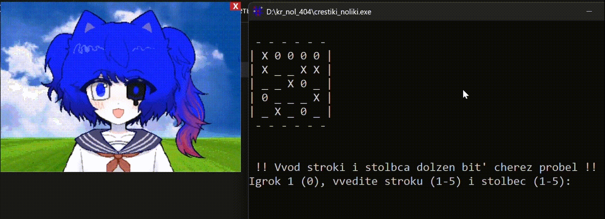

# Крестики-нолики
В игре реализованы два режима:
1. **игра с другим человеком**
2. **одиночный режим против программы** (соперник `404`)
## Особенности второго режима
* **Логика соперника:**
программа выбирает клетку по ценности линий — развивает свои ходы и блокирует опасные линии игрока
* **Интерактивные спрайты:**
при игре на Windows во время ходов алгоритма запускаются всплывающие окна с эмоциями персонажа `404` через PowerShell и небольшие фразы в самой консоли *(было сделано чтобы создать ощущение игры с персонажем, а не просто с алгоритом)*

> **ВАЖНО:**
> Полный функционал игры доступен на **Windows**;
> на **macOS и Linux** игра работает в классическом консольном режиме (диалоги алгоритма все также присутствуют)
